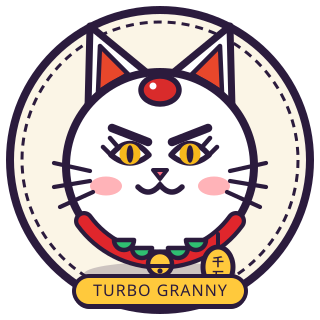

## 🐱 Official Shop Mascot: Turbo Granny (*Dandadan* — v1.2 Model)

<table>
  <tr>
    <td width="260" align="center" valign="middle">
      
    </td>
    <td valign="middle">
      <h3>🐱 TURBO GRANNY / ターボババア</h3>
      <p><em>Cursed Maneki-Neko Spirit • 100 km/h Sprint Demon • Gacha &amp; Skin Vault Keeper</em></p>
      <blockquote>
        <strong>"Ahihi! Oi brat! Got coins or gems? Pull fighters from my Gacha Capsule or grab cursed Mythic Skins from the Diamond Skin Vault — or I'll steal your bananas!"</strong>
      </blockquote>
      <p>Redesigned in <strong>v1.2</strong> (`js/granny.js` &amp; `assets/turbo-granny.svg`) with sharp furrowed brows, golden almond slit-pupil eyes with upper lashes, rosy blushing cheeks, crimson forehead patch, 5-scallop green bib over a vermilion collar, swinging golden jingle bell, and a swaying <strong>"千万" (10,000,000 Ryo)</strong> Koban medallion!</p>
    </td>
  </tr>
</table>

---

## 🥊 Fighters Roster (9 Playable Brawlers)

| Fighter | Series | Weapon | Signature Skill | Ultimate &amp; Evolution / Passive |
| :--- | :--- | :--- | :--- | :--- |
| **STRONGEST ALIEN** | *Dragon Ball* | Power Pole (*Nyoibo*) | **Kamehameha / Dragon Rush**<br>Alternates Ki blast &amp; 3x Dragon Kick rush. | **KAIOKEN BURST / GREAT APE**<br>At **HP ≤ 200** during Ult, transforms into berserk **Great Ape (Oozaru)** with **35% DMG reduction**! |
| **CHILD OF PROPHECY** | *Naruto* | Kunai | **Rasengan Dash**<br>Dashes forward with a single Rasengan slash. | **RASENSHURIKEN / SAGE EVO (10k Gold)**<br>Starter Ult throws **Rasenshuriken** (pulling Wind Vortex). **Evolve** to unlock **Sage Mode** &amp; **Four-Tails** at **HP ≤ 200** (**Bijuudama**)! |
| **WARRIOR OF LIBERATION** | *One Piece* | Gomu-Gomu Fist | **Gomu Rocket → Pistol**<br>Launches Rocket then snaps Gomu Pistol knockback. | **GEAR 4: BOUNCEMAN / SNAKEMAN**<br>**Odd HP**: Bounceman (Kong Smash + 35% shield). **Even HP**: Snakeman (wall-bouncing Black Mamba)! |
| **SUBSTITUTE REAPER** | *Bleach* | *Zangetsu / Tensa Zangetsu* | **Getsuga Tensho / Shunpo Slash**<br>Alternates Getsuga wave &amp; flash-step slash. | **SHIKAI → BANKAI EVO (10k Gold)**<br>Starter: **Shikai**, **Bankai Ult**, **Inner Demon** at **HP ≤ 100**. **Evolve**: Starts in **Bankai**, **Hollow Mask Ult**, &amp; **Vasto Lorde** at **HP ≤ 200**! |
| **ARROGANT VAMPIRE** | *JoJo's Bizarre Adventure* | *The World* &amp; Knives | **Stand Barrage**<br>Ramping punch barrage (`1→5` dmg) + vampire lifesteal/teleport. | **ZA WARUDO (TIME STOP)**<br>Freezes time, suspends frozen knives, and locks on with auto-aimed Stand barrages! |
| **STAR DELINQUENT** | *JoJo's Bizarre Adventure* | *Star Platinum* | **ORA Barrage**<br>High-speed Stand rush with ramping ORA hits + mini-slow. | **STAR PLATINUM: THE WORLD!**<br>4s Time Stop with grayscale arena &amp; heavy auto-aimed ORA barrages! |
| **HUNDRED-MAN SLAYER** | *Berserk* | *Dragonslayer* | **Dragonslayer Cleave**<br>Zero collision dmg, colossal sweeping AoE sword arc. | **BERSERKER ARMOR**<br>Dons cursed armor, surges speed, and unleashes 2x **Savage Rampage**! |
| **HONORED SORCERER** | *Jujutsu Kaisen* | Limitless | **Reversal Red / Lapse Blue**<br>Alternates knockback Red &amp; gravitational vortex Blue. | **HOLLOW PURPLE &amp; UNLIMITED VOID**<br>Fires **Hollow Purple**, activates **13s Six Eyes Infinity**, and freezes foes in **Unlimited Void**! |
| **KING OF CURSES** | *Jujutsu Kaisen* | Dismantle &amp; Cleave | **Dismantle / Cleave**<br>Slashes enemies from afar or dashes through with Cleave. | **MALEVOLENT SHRINE &amp; FUGA**<br>Opens **Malevolent Shrine** (triggers **Domain Clash** vs Gojo!) &amp; unleashes **Fuga** flame arrow! |

---

## 📣 Major Update News — Version 1.2 (UI & Character Overhaul)

> **v1.2 is a full visual & gameplay overhaul of Ball Fight!**

- 🎨 **Complete UI Revamp**: Brand-new solid comic-book theme with chunky `#2b1b3d` outlines, bottom navigation bar (`Play`, `Fighters`, `Profile`, `Shop`), crisp SVG icon sprites, mint checkerboard arena & showcase cards, plus a customizable **Profile License** (**change Display Name & custom Photo / Fighter Avatar**, persistent stats, EXP/Rank, and 6 unlockable trophies).
- 🎭 **Character Design & Dynamic Anime Faces (`js/faces.js`)**: Every fighter now has custom-drawn anime eyes, brows, and expressions (*cheerful, dark, cool, sly*) that blink, track movement, and react when charging skills or taking hits—plus redesigned **Luffy Gear 4** (*Bounceman* & *Snakeman*), **comic impact bursts**, high-speed **afterimages**, and dark outlines on **HP bars & names** so they stay readable on any character color.
- 🌟 **Fighter Evolution System (`10,000 Gold`)**: Evolve **Naruto** (*Sage Mode + Four-Tails*) and **Ichigo** (*Bankai + Hollow Mask + Vasto Lorde*). Freely toggle **Starter vs Evolved** independently for **P1 &amp; P2** to run *Base vs Evolved* matchups!
- 💀 **Diamond Skin Vault (Gems)**: Buy &amp; equip **Evo / Mythic Skins** with per-hero filters &amp; horizontal swipe carousel:
  - **Six-Tails Skeletal Kyuubi** (*Naruto*, `150 Gems`)
  - **Arrancar Arc: Ulquiorra Duel** (*Ichigo*, `120 Gems` — 2-in-1 tattered Bankai + Half-Shattered Dark-Crimson Mask)
  - **Awakened Vasto: Long-Hair Half-Mask** (*Ichigo*, `180 Gems` — Mythic long orange mane &amp; single broken Vasto horn)
- 🎰 **Hourly Rate-Up Gacha &amp; Pity 100**: All fighters are equal tier (no character rarity!). Gacha drops Coins (42%), Gems (38%), and Fighters (20%), with an **hourly rotating Rate-Up Banner** (55% of character drops) + live character preview and **Pity 100 guaranteed character** following banner odds.
- ⚔️ **Domain Clash &amp; Stand Clash**: **Gojo vs Sukuna** clash in an epic Domain Expansion tug-of-war, while **DIO vs Jotaro** trigger Stand Clashes!
- 🔊 **Procedural Web Audio SFX (`js/sfx.js`)**: Custom synthesized sounds per skill, ultimate, UI click, and gacha capsule—with zero external audio files.
- 📱 **9:16 Vertical Recording Mode (`REC`)**: One-click vertical framing for TikTok, Reels, and Shorts.

---

## 🎮 Controls

| Key / Button | Action |
| :--- | :--- |
| `Space` | Quick Start Match / Pause / Resume battle |
| `R` | Quick Reset Match (Back to Round 1) |
| `Esc` | Close active modal / Exit 9:16 `REC` Mode |
| `1X / 2X` | Toggle simulation speed (Normal / Turbo) |
| `SFX: ON / OFF` | Toggle procedural sound effects |
| `REC` | Toggle 9:16 social-media recording viewport |
| `Profile x10` | Secret Admin Control Panel (adjust Gold, Gems &amp; unlocks) |

---

## 🚀 Run Locally

```bash
# Clone the repository
git clone https://github.com/Epithap/BallFight.git
cd BallFight

# Serve locally with npx (or open index.html directly)
npx serve .
```

Replay a deterministic seed:
```text
http://localhost:3000/?seed=777
```

---

## 🛠️ Architecture

```text
ball/
├── index.html            # Screens, overlay modals, SVG icon sprites & script order
├── style.css             # Solid comic-book theme, horizontal carousels & responsive UI
├── game.js               # 60 FPS physics loop, evolution overrides, UI & battle engine
├── assets/
│   ├── hero-banner.svg   # Animated arena clash banner
│   └── turbo-granny.svg  # Redesigned v1.2 Turbo Granny mascot SVG
└── js/
    ├── constants.js      # Shared BallFight namespace (BF), palette & constants
    ├── sound.js          # Core Web Audio synthesizer
    ├── sfx.js            # Character skill, ult, UI & gacha procedural SFX
    ├── shop.js           # Wallet persistence, Evolution specs & Diamond Skin Vault
    ├── forms.js          # 2-tier evolution stages & previewable character forms
    ├── faces.js          # Dynamic anime eyes, brows & expressions per fighter
    ├── granny.js         # v1.2 animated Turbo Granny canvas renderer
    ├── gacha.js          # Capsule gacha pulls, pity counter & collection tracker
    └── characters/       # Modular fighter definitions, skills, costumes & weapons
```

---

<p align="center">
  <sub>Built with ❤️ and pure anime hype. Powered by HTML5 Canvas. Ahihi!</sub>
</p>
