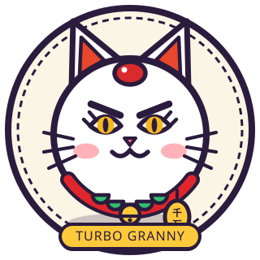

<p align="center">
  
</p>

<h1 align="center">⚡ BALL FIGHT — Anime Ball Physics Battler (v1.3.1)</h1>

<p align="center">
  <strong>15 Playable Anime Fighters • HSR-Style Dual Gacha • Daily Missions • Domain &amp; Stand Clashes • 60 FPS HTML5 Canvas</strong>
</p>

---

## 📋 Changelog

### ✨ Version 1.3.1 — Dual Gacha Revamp, Daily Missions &amp; Stability Patch
- **🎰 HSR-Style Dual Gacha (`Pity 60`)**:
  - **Standard Banner (`300` / `3,000 Coins`)**: Big Three pool (`Naruto`, `Luffy`, `Ichigo`) with `0.5%` character rate, transparent trio splash art background, and **Pity 60 guaranteed**.
  - **Hourly Rate-Up Banner (`30` / `300 Gems`)**: Rotates featured fighters every 1 hour with **50/50 + Guaranteed** mechanics, shared **Pity 60** across rotations, and transparent per-character anime splash art.
- **🎯 Daily Missions Popup (Header)**:
  - Added a **Daily Missions** button &amp; modal right beside the **BALL FIGHT** header with a red claim notification dot.
  - **5 Daily Missions** (auto-reset per local calendar day) awarding up to **1,800 Coins + 150 Gems/day**, plus **+5 Gems** per Player 1 match victory.
- **⚖️ Balance &amp; Progression**:
  - **Evolution Cost (`25,000 Gold`)**: Updated Evolution unlock cost for **Naruto**, **Ichigo**, and **Sasuke** from `10k` to `25k Gold`.
  - **Goku Great Ape (Oozaru)**: Now triggers as a clutch trump card when casting **Ultimate at HP &lt; 50** (instead of `HP <= 200`).
- **🔧 Minor Fixes &amp; Performance**:
  - Fixed **Sasuke** *Susanoo* / *Indra's Arrow* arena animation &amp; Char Detail preview framing.
  - Fixed **Cosmic Garou** *Gamma Ray Burst* lingering after battle ends + upgraded **Moon Sanctuary** outer-space backdrop.
  - Modularized `game.js` into `js/vfx.js`, `js/clashes.js`, and `js/transforms.js` with full runtime verification (zero freeze/crash on skills, transforms, and clashes) and capped mobile DPR (`<= 1.5`) for smoother phone performance.

### 🌌 Version 1.3 — New Fighters, Cosmic Moon Arena &amp; Stand Clash 2.0
- **4 New / Revamped Fighters**: **Garou** (*Hero Hunter / Monster / Cosmic Fear* + *Moon Sanctuary Arena* + *Gamma Ray Burst*), **Denji** (*Twin Chainsaw Launch* + *5s Wall-Bouncing Revving Saw Rush* + *Hero of Hell*), **Sung Jin-Woo** (*ARISE: Monarch's Domain* with Igris, Tank, Beru &amp; Kaisel), and **Killua Zoldyck** (*50-Kg Alloy Yo-Yo* + *Godspeed: Kanmuru*).
- **Stand Clash 2.0 &amp; Reworks**: Upgraded **DIO vs Jotaro** Stand Clash with *Stand-Crush Knockback Finisher*, plus **Jotaro** &amp; **Guts** skill reworks.

### 🎨 Version 1.2 — Complete UI, Evolutions &amp; Procedural SFX Overhaul
- Solid comic-book UI (`#2b1b3d` outlines), bottom nav (`Play`, `Fighters`, `Profile`, `Shop`), Profile License customization, dynamic anime faces (`js/faces.js`), Evolution System, Diamond Skin Vault, MUGEN-style Gacha animations, Web Audio SFX (`js/sfx.js`), and `9:16` vertical `REC` mode.

---

## 🐱 Official Shop Mascot: Turbo Granny (*Dandadan* — v1.2 Model)

<table>
  <tr>
    <td width="260" align="center" valign="middle">
      
    </td>
    <td valign="middle">
      <h3>🐱 TURBO GRANNY / ターボババア</h3>
      <p><em>Cursed Maneki-Neko Spirit • 100 km/h Sprint Demon • Gacha &amp; Skin Vault Keeper</em></p>
      <blockquote>
        <strong>"Ahihi! Oi brat! Got coins or gems? Pull fighters from my Gacha Capsule or grab cursed Mythic Skins from the Diamond Skin Vault — or I'll steal your bananas!"</strong>
      </blockquote>
      <p>Designed in <code>js/granny.js</code> &amp; <code>assets/turbo-granny.svg</code> with sharp furrowed brows, golden almond slit-pupil eyes, crimson forehead patch, 5-scallop green bib, swinging golden jingle bell, and a swaying <strong>"千万" (10,000,000 Ryo)</strong> Koban medallion!</p>
    </td>
  </tr>
</table>

---

## 🥊 Fighters Roster (15 Playable Brawlers)

| Fighter | Series | Weapon | Signature Skill | Ultimate &amp; Evolution / Passive |
| :--- | :--- | :--- | :--- | :--- |
| **STRONGEST ALIEN** *(Starter)* | *Dragon Ball* | Power Pole (*Nyoibo*) | **Kamehameha / Dragon Rush**<br>Alternates Ki blast &amp; 3x Dragon Kick rush. | **KAIOKEN BURST / GREAT APE**<br>At **HP &lt; 50** during Ult, transforms into **Great Ape (Oozaru)** with **35% shield** &amp; **Ape Rush**! |
| **CHILD OF PROPHECY** | *Naruto* | Kunai | **Rasengan Dash**<br>Dashes forward with a single Rasengan slash. | **RASENSHURIKEN / SAGE EVO (`25k Gold`)**<br>Starter Ult throws **Rasenshuriken**. **Evolve** for **Sage Mode** &amp; **Four-Tails** (`HP <= 200`, **Bijuudama**)! |
| **UCHIHA AVENGER** | *Naruto* | Chokuto / Chidori | **Chidori / Fireball**<br>Lightning dash &amp; Amaterasu/Fireball bursts. | **CURSE MARK / RINNEGAN EVO (`25k Gold`)**<br>Starter: **Curse Mark** + **Kirin** / **Susanoo**. **Evolve**: **Rinnegan**, **Susanoo Armor** (`HP <= 150`), &amp; **Indra's Arrow**! |
| **WARRIOR OF LIBERATION** | *One Piece* | Gomu-Gomu Fist | **Gomu Rocket → Pistol**<br>Launches Rocket then snaps Gomu Pistol knockback. | **GEAR 4: BOUNCEMAN / SNAKEMAN**<br>**Odd HP**: Bounceman (Kong Smash + 35% shield). **Even HP**: Snakeman (wall-bouncing Black Mamba)! |
| **SUBSTITUTE REAPER** | *Bleach* | *Zangetsu / Tensa Zangetsu* | **Getsuga Tensho / Shunpo Slash**<br>Alternates Getsuga wave &amp; flash-step slash. | **SHIKAI → BANKAI EVO (`25k Gold`)**<br>Starter: **Shikai**, **Bankai Ult**, **Inner Demon** (`HP <= 100`). **Evolve**: **Bankai**, **Hollow Mask Ult**, &amp; **Vasto Lorde** (`HP <= 200`)! |
| **ARROGANT VAMPIRE** | *JoJo's Bizarre Adventure* | *The World* &amp; Knives | **Stand Barrage**<br>Ramping punch barrage + vampire lifesteal/teleport. | **ZA WARUDO (TIME STOP)**<br>Freezes time, suspends frozen knives, and locks on with auto-aimed Stand barrages! |
| **STAR DELINQUENT** | *JoJo's Bizarre Adventure* | *Star Platinum* | **ORA Barrage / Star Finger**<br>High-speed Stand rush + Star Catch &amp; Yare Yare Daze. | **STAR PLATINUM: THE WORLD!**<br>4s Time Stop with grayscale arena &amp; heavy Time-Step Beatdown! |
| **HUNDRED-MAN SLAYER** | *Berserk* | *Dragonslayer* | **Dragonslayer Cleave / Arm Cannon**<br>Sweeping AoE sword arc, Bleed Cleave &amp; Arm Cannon. | **BERSERKER ARMOR**<br>Dons cursed armor, activates *Struggler's Grit*, and unleashes **Savage Rampage**! |
| **HONORED SORCERER** | *Jujutsu Kaisen* | Limitless | **Reversal Red / Lapse Blue**<br>Alternates knockback Red &amp; gravitational vortex Blue. | **HOLLOW PURPLE &amp; UNLIMITED VOID**<br>Fires **Hollow Purple**, activates **Six Eyes Infinity**, and freezes foes in **Unlimited Void**! |
| **KING OF CURSES** | *Jujutsu Kaisen* | Dismantle &amp; Cleave | **Dismantle / Cleave**<br>Slashes enemies from afar or dashes through with Cleave. | **MALEVOLENT SHRINE &amp; FUGA**<br>Opens **Malevolent Shrine** (triggers **Domain Clash** vs Gojo!) &amp; unleashes **Fuga** flame arrow! |
| **LIGHTNING ASSASSIN** | *Hunter × Hunter* | 50-Kg Alloy Yo-Yo | **Yo-Yo Sweep / Izutsushi**<br>Out-and-back yo-yo + Rhythm Echo lightning palm. | **GODSPEED: KANMURU**<br>*Whirlwind Auto-Counter* &amp; *Shippujinrai* lightning speed! |
| **ENHANCER PRODIGY** | *Hunter × Hunter* | Jajanken Fist | **Jajanken: Rock / Scissors / Paper**<br>Versatile Enhancer charge strikes. | **ADULT GON (RESTRICTION)**<br>Unleashes overwhelming dark aura &amp; devastating Jajanken finishers! |
| **SHADOW MONARCH** | *Solo Leveling* | *Knight Killer &amp; Baruka* | **Vital-Point Mutilation / Ruler's Authority**<br>Twin dagger combos &amp; telekinetic pull + slam. | **ARISE: MONARCH'S DOMAIN**<br>Summons **Igris**, **Tank**, **Beru**, and a **Kaisel** sky-dive finale! |
| **CHAINSAW DEVIL** | *Chainsaw Man* | Twin Chainsaws | **Twin Chainsaw Launch / Revving Saw Rush**<br>Fires spinning saws &amp; 5s wall-bouncing rush. | **HERO OF HELL**<br>4 chainsaw arms, *Blood Lifesteal*, and relentless shredding! |
| **HERO HUNTER** | *One-Punch Man* | Martial Arts | **Water Stream / Whirlwind Iron**<br>Projectile counter-deflect &amp; spiral waves. | **MONSTER FORM &amp; COSMIC FEAR (`HP < 100`)**<br>Ascends to the **Moon Sanctuary Arena** &amp; detonates **Full-Arena Gamma Ray Burst**! |

---

## 🎮 Controls

| Key / Button | Action |
| :--- | :--- |
| `Space` | Quick Start Match / Pause / Resume battle |
| `R` | Quick Reset Match (Back to Round 1) |
| `Esc` | Close active modal / Exit 9:16 `REC` Mode |
| `1X / 2X` | Toggle simulation speed (Normal / Turbo) |
| `SFX: ON / OFF` | Toggle procedural sound effects |
| `REC` | Toggle 9:16 social-media recording viewport |
| `Daily Missions` | Header medal button — claim daily Coins &amp; Gems |
| `Profile x10` | Secret Admin Control Panel (adjust Gold, Gems &amp; unlocks) |

---

## 🚀 Run Locally

```bash
# Clone the repository
git clone https://github.com/Epithap/BallFight.git
cd BallFight

# Serve locally with npx (or open index.html directly)
npx serve .
```

Replay a deterministic seed:
```text
http://localhost:3000/?seed=777
```

---

## 🛠️ Architecture

```text
ball/
├── index.html            # Screens, Daily Missions & What's New modals, SVG sprites & script order
├── style.css             # Solid comic-book theme, carousels & responsive mobile UI
├── game.js               # Core 60 FPS physics loop, Ball class, BF._rt bridge & match engine
├── assets/
│   ├── hero-banner.svg   # Animated arena clash banner
│   ├── turbo-granny.svg  # Turbo Granny mascot SVG
│   └── gacha-bg/         # Transparent anime splash arts for Standard & Rate-Up banners
└── js/
    ├── constants.js      # Shared BallFight namespace (BF), palette & constants
    ├── sound.js          # Core Web Audio synthesizer
    ├── sfx.js            # Character skill, ult, UI & gacha procedural SFX
    ├── shop.js           # Wallet persistence, 25k Gold Evolutions & Diamond Skin Vault
    ├── forms.js          # Evolution stages & previewable character forms
    ├── faces.js          # Dynamic anime eyes, brows & expressions per fighter
    ├── granny.js         # Animated Turbo Granny canvas renderer
    ├── gacha.js          # Dual Banner gacha, Pity 60, 50/50 + Guarantee & MUGEN reveals
    ├── missions.js       # Daily Missions tracker, auto-reset & reward claims
    ├── vfx.js            # Projectiles, shock rings, cast indicators, time-resume & cut-ins
    ├── clashes.js        # Stand Clash 2.0 & Domain Expansion Clash
    ├── transforms.js     # Ultimate & Awakening transformations
    └── characters/       # 15 modular fighter files (goku..garou)
```

---

<p align="center">
  <sub>Built with ❤️ and pure anime hype. Powered by HTML5 Canvas. Ahihi!</sub>
</p>
