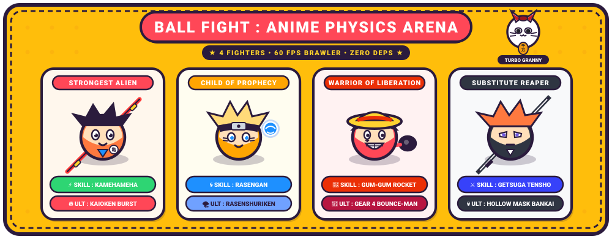

<p align="center">
  
</p>

<h1 align="center">⚡ BALL FIGHT</h1>

<p align="center">
  <strong>Anime Ball Physics Battler powered by HTML5 Canvas &amp; Vanilla JavaScript.</strong><br>
  Pick from 15 iconic anime fighters, bounce inside the arena, trigger signature skills, Domain &amp; Stand Clashes, unlock Evolutions &amp; Mythic Skins, complete Daily Missions, and pull characters in an HSR-style Dual Gacha!
</p>

---

## 🎯 What Is This Project?

**Ball Fight** is a fast-paced 2D physics battle simulator inspired by anime arena brawlers and viral ball-bounce combat reels (`1v1` automated physics + skill/ultimate timing, plus a `9:16` vertical **REC** mode for Shorts/Reels/TikTok). Every fighter has custom canvas art, dynamic anime facial expressions, procedural Web Audio SFX, and unique transformations.

- **15 Playable Fighters**: Goku, Naruto, Sasuke, Luffy, Ichigo, DIO, Jotaro, Guts, Gojo, Sukuna, Killua, Gon, Sung Jin-Woo, Denji, and Garou.
- **HSR-Style Dual Gacha (`Pity 60`)**: Standard Coin Banner (`Naruto`, `Luffy`, `Ichigo`) + Hourly Rate-Up Gem Banner (`50/50 + Guaranteed`).
- **Daily Missions &amp; Progression**: Daily Coin/Gem quests, Fighter Evolutions (`25,000 Gold`), and Diamond Skin Vault.
- **Zero Build Tools**: Pure HTML, CSS, and modular JavaScript (`index.html`, `style.css`, `game.js`, `js/`).

> Looking for full patch notes and developer architecture? See [CHANGELOG.md](CHANGELOG.md).

---

## 🐱 Official Shop Mascot: Turbo Granny (*Dandadan*)

<table>
  <tr>
    <td width="240" align="center" valign="middle">
      
    </td>
    <td valign="middle">
      <h3>🐱 TURBO GRANNY / ターボババア</h3>
      <p><em>Cursed Maneki-Neko Spirit • 100 km/h Sprint Demon • Gacha &amp; Skin Vault Keeper</em></p>
      <blockquote>
        <strong>"Ahihi! Oi brat! Got coins or gems? Pull fighters from my Gacha Capsule or grab cursed Mythic Skins from the Diamond Skin Vault — or I'll steal your bananas!"</strong>
      </blockquote>
    </td>
  </tr>
</table>

---

## 🎮 Controls &amp; Run Locally

| Key / Button | Action |
| :--- | :--- |
| `Space` | Start / Pause / Resume match |
| `R` | Quick Reset match |
| `Esc` | Close modal / Exit `9:16 REC` mode |
| `1X / 2X` | Toggle simulation speed |
| `SFX` / `REC` | Toggle procedural audio / `9:16` recording viewport |

```bash
git clone https://github.com/Epithap/BallFight.git
cd BallFight
npx serve .
```

<p align="center">
  <sub>Built with ❤️ and pure anime hype. Powered by HTML5 Canvas. Ahihi!</sub>
</p>
